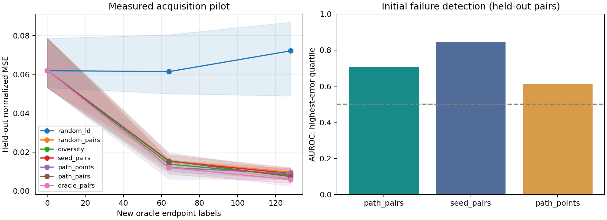

# When Simplicity Learns the Wrong Rule

PyTorch experiments on regularization and compositional generalization. The benchmark tests whether networks preserve distinctions needed for unfamiliar input combinations, then compares ways to select new training examples.

## Results

The CPU pilot used three teacher instances and 351 training runs. After 128 new labels, mean held-out normalized MSE was:

| Acquisition method | NMSE |
|---|---:|
| Random paired samples | 0.009734 |
| Diversity sampling | 0.008066 |
| Seed committee | 0.008990 |
| Regularization path, point scores | 0.008922 |
| Regularization path, pair scores | 0.007418 |

Pair scores gave 23.8% lower mean error than random paired sampling in this pilot. The seed committee was the stronger initial failure detector, with AUROC 0.845 compared with 0.706 for path-pair scores. These are preliminary results from one teacher family and one training seed per teacher.



Full measurements are in [the acquisition report](results/pilot_active/RESULTS.md) and [the coverage sweep](results/pilot_sweep/RESULTS.md).

## Setup

Requires Python 3.10 or newer.

```bash
python -m venv .venv
source .venv/bin/activate
python -m pip install -e .
```

On Windows, use `.venv\Scripts\activate` to activate the environment. To install CPU-only Torch on Linux:

```bash
python -m pip install torch --index-url https://download.pytorch.org/whl/cpu
python -m pip install -e .
```

Tested with Python 3.12, PyTorch 2.14.1+cpu, and NumPy 2.3.5 on Linux. Exact package versions are recorded in `results/environment_tested.json`.

## Experiments

Tests:

```bash
python -m unittest discover -s tests -v
```

Small run with all seven acquisition methods:

```bash
python -m wrongrule active --config configs/smoke.json --out results/my_smoke
```

Coverage and weight-decay sweep:

```bash
python -m wrongrule sweep --config configs/pilot_sweep.json --out results/my_sweep
```

Acquisition pilot:

```bash
python -m wrongrule active --config configs/pilot_active.json --out results/my_active
```

Ridge-regression check:

```bash
python -m wrongrule analytic --out results/my_analytic
```

Regenerate a report:

```bash
python -m wrongrule report --run results/my_active
```

Use a new output directory for each run. Reports are also generated automatically. The larger configuration in `configs/confirmation_active.json` has not been run.

## Method

The target is a seeded computation graph of bounded two-input functions. Training varies how often two inputs change independently while keeping their individual distributions fixed.

The acquisition experiment uses separate training, query, and final-test combination cells. A committee varies regularization while keeping initialization and batch order fixed. Its pair score measures disagreement about the output change caused by an input edit. A second committee varies initialization instead. Random sampling, diversity sampling, point uncertainty, and an oracle reference provide controls.

All acquisition arms have the same committee-training budget. The label ledger counts new endpoints and caches repeated points. Model selection uses ID validation. The oracle reference has additional label access and is reported separately.

## Project layout

| File | Purpose |
|---|---|
| `wrongrule/data.py` | Target functions, support partitions, interventions, label budgets |
| `wrongrule/models.py` | MLP and spectral measurements |
| `wrongrule/training.py` | Training and committee construction |
| `wrongrule/acquisition.py` | Audit scores and sampling policies |
| `wrongrule/metrics.py` | Prediction and evaluation |
| `wrongrule/experiments.py` | Experiment runners |
| `wrongrule/analysis.py` | Ridge calculation, summaries, plots |
| `configs/` | Experiment settings |
| `tests/` | Thirteen correctness tests |

Commands save checkpoints, loss traces, raw metrics, selected pairs, and label costs. Source hashes in existing experiment manifests refer to the code used for those runs. `docs/style_cleanup.json` records the later comment and docstring cleanup, which leaves executable syntax unchanged.

## References and scope

See [references](docs/SOURCES.md), [experimental protocol](docs/PROTOCOL.md), and [experiment report](docs/IMPLEMENTATION_REPORT.md).

The study builds on work on compositional sparsity, optimization bias, and system identification. It is independent of the cited labs. Weight decay here does not implement the multiplicative norm constraint in Huang et al.

The visual benchmark, modular-hyperteacher extension, causal rank-removal experiments, and nonlinear theorem remain future work. This pilot does not establish novelty or a general advantage over active-learning baselines.
